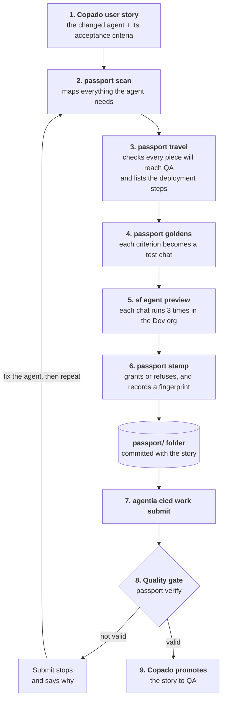

# How Agent Passport works

Agent Passport is a plugin for the Copado Agentia CLI. Before an Agentforce agent is promoted from one environment to
the next (for example from Dev to QA), it checks that the agent is complete, that it behaves the way its user story
says, and that nothing changed after it was tested. If any of that fails, Copado stops the story from moving on.

This page explains how the pieces fit together. A short example at the end walks through one story from start to
finish.

## A few terms first

If you haven't worked with Agentforce or Copado, these are the only terms you need:

| Term | What it means |
|---|---|
| **Agentforce agent** | An AI assistant built in Salesforce. It decides what to do from a customer's message, then runs *actions*, which call Flows, Apex classes or prompt templates to do the actual work, such as creating a case. |
| **Environment** | A separate Salesforce org for each stage of work: Dev for building, QA for testing, and so on. |
| **User story** | One tracked change in Copado. It holds the changed files and the *acceptance criteria*: plain sentences saying what the change must do. |
| **Pipeline** | The route a story takes through the environments. Each environment has its own Git branch. |
| **Promotion** | Moving a story to the next environment. Copado deploys the story's files to that org. |
| **Agentia CLI** | Copado's command line tool. Developers use it to work on stories (`agentia cicd work ...`) from their own machine. |
| **Local quality gate** | A script in the project that Agentia runs before it submits a story. If the script fails, the submit stops. |

The problem in one line: an agent is made of many files, and its behaviour comes from a language model. Copado can
deploy every file successfully and still ship an agent that is missing a Flow, or one that no longer does what the
story asked. Agent Passport closes that gap.

## The big picture

Steps 2 to 6 build the passport. Steps 7 and 8 are where Copado checks it. A developer can run each step by hand, or
ask a coding agent such as Claude Code to run them all.

Everything Agent Passport does happens on the developer's machine. It reads Copado data (the story and the pipeline)
only through the Agentia CLI, compares files using Git, and reads the test results that the Salesforce CLI saves. It
keeps its own results as files in the story's Git branch, and lets Agentia's quality gate decide whether the story may
move on.

## The parts

### Agentia CLI and the plugin

Agent Passport is installed into the Agentia CLI as a plugin, so its commands look like any other Agentia command:
`agentia passport scan`, `agentia passport stamp`, and so on. The plugin asks the Agentia CLI for what it needs from
Copado: the active story, its acceptance criteria, and the pipeline (which branch belongs to which environment). It
never calls Copado directly and never sees any login details.

### The three checks

Each check answers one question.

**1. Is everything packed?** `passport scan` reads the agent's source files and follows every link: the agent, its
subagents (or topics), their actions, and the Flows, Apex classes and prompt templates those actions call. The result
is a dependency map. `passport travel` then compares that map with the next environment's Git branch. Each piece is
either *in the story*, *already on the target*, or a *gap* that will not arrive. Some things are not files at all, such
as the user the agent runs as, or publishing and activating the agent. For those, travel writes ready-made Copado
deployment steps, which are instructions attached to the story.

**2. Does it behave?** `passport goldens init` turns each acceptance criterion into a short test chat, called a golden
conversation: a customer message, plus what should happen (which part of the agent should handle it, and which actions
must or must not run). `passport goldens plan` prints the exact `sf agent preview` commands to run each chat against
the Dev org. Each chat runs three times, because a language model doesn't always make the same choice. `passport stamp`
then reads what the agent actually did in every run and checks it. All runs must pass, or the stamp is refused.

**3. Has anything changed since?** When a stamp is granted, it records a fingerprint: a hash of every file in the
dependency map, plus a hash of the test chats. Change one line in any of them and the fingerprint no longer matches, so
the stamp is *stale*.

### The passport/ folder

All results are plain files in the project, committed to the story branch like code:

| File | Written by | Holds |
|---|---|---|
| `passport/graph.json` | `scan` | the dependency map |
| `passport/travel-<target>.json` | `travel` | what will and won't arrive, and the proposed deployment steps |
| `passport/goldens/<agent>.json` | `goldens init`, then the developer | the test chats |
| `passport/stamps/<env>/<agent>.json` | `stamp` | the verdict, pass rates and fingerprint, one stamp per environment |
| `passport/baselines/<agent>.json` | `stamp` | the last good behaviour, used to spot regressions |
| `passport/report.html` | `report` | one readable page for reviewers |

Because the evidence travels with the story, a reviewer sees it in the same place as the change itself.

### The quality gate

`passport setup` adds a short, clearly marked block to the project's `.agentia_quality_gates.sh` and `.cmd` scripts, which runs
`passport verify`. Any gates the project already has, such as Apex tests, keep running. Agentia runs these scripts
during `agentia cicd work test` and before `agentia cicd work submit`.

`verify` passes only when all of these are true:

- the scan found no errors,
- a stamp exists for this environment and was granted,
- the stamp's fingerprint still matches the files,
- every dependency will reach the next environment.

If any of them fails, `verify` exits with an error, and Agentia stops the submit before it pushes anything to Git or
contacts Copado. The developer sees a short table saying exactly which check failed and why.

### The skill and MCP

`passport setup` also installs an agent skill: a written guide that tells a coding agent such as Claude Code or Cursor
the steps in order and the rules (fix the agent, never weaken a test, never edit the evidence, never skip the gate).
When the coding agent needs to add the proposed deployment steps to the story, it uses the tools from Agentia's MCP
server, which is built into the Agentia CLI. A developer working without a coding agent runs the same commands by
hand.

## What it deliberately doesn't do

- It never runs commands against a Salesforce org. It prints the `sf agent preview` commands, and reads the files they
  save.
- It never calls Copado or Salesforce directly, and never handles credentials.
- It doesn't replace Copado's own validation or promotion. It only decides whether the story may be submitted.

Keeping it this narrow means the plugin is easy to trust: it reads files and Git, writes files, and returns pass or
fail.

## An example, start to finish

A team has a customer service agent. A developer picks up a story in Copado:

> **US-0000025:** A refund request routes to the resolution subagent. The agent creates a real case and tells the
> customer the case number.

The developer changes the agent so it can escalate difficult cases. That change needs a new Flow called
`EscalateCase`.

**Packed?** The developer runs `scan` and `travel`. Travel reports that `EscalateCase` exists on the developer's
machine but was never committed to the story. If the story were promoted now, the Flow would not reach QA and the
agent would fail there. Travel also proposes two deployment steps for QA: make sure the agent's user exists, and
publish and activate the agent.

**Behaves?** `goldens init` turns the two acceptance criteria into two test chats:

- AC-1: *"I was charged twice for my last order and I want a refund"*, which should reach the resolution subagent.
- AC-2: *"My order arrived damaged. Please open a support case for me and tell me the case number."*, which should
  run the `create_case` action.

Each chat runs three times against the Dev org. Both fail every time. In AC-1 the agent passes a broken placeholder,
`{!state.issue_type}`, to the escalation Flow instead of real text. In AC-2 the agent says a case is being created,
but never actually creates one. `stamp` refuses the stamp.

**Copado says no.** The developer runs `agentia cicd work test`. The gate runs `verify`, which finds the refused stamp
and the missing Flow, and the command fails. `work submit` would stop at the same point, before anything reaches QA.

**Fix and pass.** The developer fixes the agent, not the tests: it now creates the case first and passes real values
to escalation, and the missing Flow is committed. The same two chats run again, three times each, and pass every time.
The stamp is granted, the report is committed with the story, and `work submit` goes through.

**Drift.** Later, someone changes one line in the agent. The fingerprint no longer matches, so the stamp is stale and
the next submit stops until the chats are run and the agent is stamped again.

At every step, the reason for a "no" is written down in plain words, and the proof for a "yes" travels with the story
for anyone to check.
